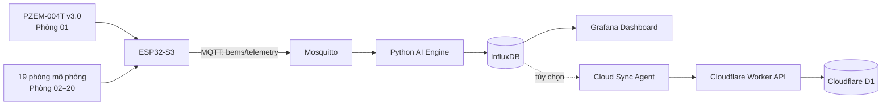

BEMS AIoT – ESP32-S3, 01 PZEM thật và 19 phòng mô phỏng

1. Tổng quan và phạm vi mô hình
BEMS (Building Energy Management System) là mô hình giám sát và phân tích mức tiêu thụ năng lượng của các phòng trong một tòa nhà. Hệ thống trong đề tài sử dụng mô hình Hybrid: 01 phòng đo bằng cảm biến thật và 19 phòng tạo dữ liệu mô phỏng.
Thành phần	Số lượng	Vai trò
ESP32-S3	01	Bộ điều khiển, đọc cảm biến và gửi telemetry
PZEM-004T v3.0	01	Đo điện thực tế cho Phòng 01
Phòng mô phỏng	19	Phòng 02 đến Phòng 20, dữ liệu do firmware tạo
MQTT / Mosquitto	01 broker	Nhận bản tin telemetry từ ESP32-S3
Python AI Engine	01 dịch vụ	Xử lý dữ liệu, cảnh báo, tính chi phí, dự báo và Demand Response mô phỏng
InfluxDB	01 cơ sở dữ liệu	Lưu dữ liệu chuỗi thời gian tại máy chủ local
Grafana	01 giao diện	Hiển thị dữ liệu và dashboard
Cloudflare Worker + D1	Tùy chọn	Nhận và lưu bản sao dữ liệu trên Cloud

Quy tắc phân biệt dữ liệu thật và dữ liệu mô phỏng
- Phòng 01: room_id = 1, source = "pzem004t_v3", simulated = false. Đây là dữ liệu cảm biến thật khi PZEM đọc hợp lệ.
- Phòng 02–20: simulated = true, source = "synthetic_generator". Đây là dữ liệu mô phỏng sinh bởi ESP32-S3.
- Nếu PZEM không phản hồi hoặc số đo không hợp lệ, Phòng 01 phải được đánh dấu valid = false. Hệ thống không thay số đo PZEM lỗi bằng số liệu giả.
- Không trình bày 19 phòng mô phỏng như 19 công tơ hoặc 19 cảm biến đo điện thật.
- Mô hình hiện tại không có relay. Demand Response chỉ thay đổi trạng thái/hệ số tải ảo của Phòng 02–20, không đóng/ngắt thiết bị điện thật.

2. Kiến trúc hệ thống

Luồng hoạt động local:
1. ESP32-S3 đọc PZEM ở Phòng 01 và tạo dữ liệu mô phỏng cho Phòng 02–20.
2. ESP32-S3 đóng gói dữ liệu thành JSON và gửi đến MQTT topic bems/telemetry.
3. Python AI Engine nhận bản tin, kiểm tra dữ liệu và ghi vào InfluxDB.
4. AI Engine thực hiện các chức năng tính toán chi phí, phát hiện bất thường, dự báo và Demand Response mô phỏng theo cấu hình dự án.
5. Grafana truy vấn InfluxDB để hiển thị dữ liệu.
6. Nếu triển khai phần Cloud Backup, Cloud Sync Agent đọc dữ liệu từ InfluxDB rồi gửi qua Worker API để lưu vào D1.
Lưu ý: Cloud Backup là nhánh mở rộng đọc dữ liệu từ InfluxDB. ESP32-S3 không cần gửi trực tiếp đến D1. Không nhầm Cloudflare D1 với InfluxDB: InfluxDB là kho dữ liệu chuỗi thời gian local, D1 là bản lưu dữ liệu trên Cloud.

3. Yêu cầu máy tính và phần mềm
3.1. Cấu hình máy tính khuyến nghị
Thành phần	Mức tối thiểu khuyến nghị	Ghi chú
Hệ điều hành	Windows 10/11 64-bit	Khuyến nghị Windows 11; Docker Desktop sử dụng WSL 2 backend
RAM	8 GB	16 GB trở lên sẽ thoải mái hơn khi chạy Docker, InfluxDB, Grafana và AI Engine cùng lúc
CPU	4 luồng xử lý trở lên	Bật Virtualization trong BIOS/UEFI nếu dùng máy Windows với WSL 2
Dung lượng trống	Nên có ít nhất 15–20 GB	Docker image, InfluxDB volume và log sẽ chiếm dung lượng
Mạng	Wi-Fi/LAN nội bộ	Máy chạy Docker và ESP32-S3 phải liên lạc được qua LAN
USB	01 cổng USB dữ liệu	Dùng nạp firmware và mở Serial Monitor
Đây là mức khuyến nghị để chạy đồ án, không phải yêu cầu tối thiểu chính thức của mọi phiên bản Docker hoặc ESP32.

3.2. Phần mềm cần cài
Phần mềm	Dùng để làm gì	Tải từ nguồn chính thức
Docker Desktop for Windows	Chạy MQTT, AI Engine, InfluxDB và Grafana	Docker Desktop for Windows
WSL 2 (Windows)	Backend Linux cho Docker Desktop	Hướng dẫn WSL của Docker
Arduino IDE 2.x	Biên dịch và nạp firmware ESP32-S3	Arduino Software
Python 3.11	Chạy test Python và các công cụ hỗ trợ	Python
Git for Windows (không bắt buộc)	Tải/cập nhật mã nguồn nếu dự án được lưu trên Git	Git for Windows
Driver USB-UART (nếu cần)	Nhận cổng COM của bo ESP32-S3	Cài theo chip USB-UART thực tế trên bo, ví dụ CP210x hoặc CH340

3.3. Cài Docker trên Windows
1. Bật tính năng ảo hóa CPU trong BIOS/UEFI nếu máy chưa bật.
2. Mở PowerShell bằng quyền Administrator và chạy:
   wsl --install
   wsl --update
   wsl --version
3. Khởi động lại Windows nếu hệ thống yêu cầu.
4. Tải và cài Docker Desktop từ Docker Desktop for Windows.
5. Mở Docker Desktop, đợi trạng thái Engine chạy ổn định.
6. Vào Settings → General, xác nhận đang dùng WSL 2 based engine nếu chọn backend WSL 2.
7. Mở PowerShell mới và kiểm tra:
   docker --version
   docker compose version
Nếu hai lệnh trên trả về phiên bản thì có thể tiếp tục. Hướng dẫn cài đặt và yêu cầu hệ thống có thể thay đổi theo phiên bản Docker; xem tài liệu chính thức ở mục Nguồn tài liệu.

4. Nhận mã nguồn và kiểm tra thư mục
Giải nén dự án vào đường dẫn dễ thao tác, tránh thư mục có dấu tiếng Việt hoặc ký tự đặc biệt. Ví dụ trên Windows:
C:\BEMS_AIOT_1PZEM_19SIM\
Cấu trúc thư mục dự kiến:
BEMS_AIOT_1PZEM_19SIM/
├── firmware/
│   └── main.ino
├── backend/
│   └── server_ai_bems.py
├── tests/
│   ├── test_evntariff.py
│   └── test_hybrid_payload.py
├── grafana/
│   └── provisioning/
│       └── datasources/
│           └── influxdb.yml
├── mosquitto/
│   └── mosquitto.conf
├── Dockerfile
├── docker-compose.yml
├── requirements.txt
├── .env.example
└── README.md
Nếu bạn nhận thêm thư mục cloud-sync/ thì đó là phần đồng bộ dữ liệu lên Cloudflare, được hướng dẫn riêng ở mục 15.
Kiểm tra file trên Windows PowerShell
cd C:\BEMS_AIOT_1PZEM_19SIM
Get-ChildItem
Test-Path .\docker-compose.yml
Test-Path .\.env.example
Test-Path .\firmware\main.ino
Test-Path .\backend\server_ai_bems.py
Các lệnh Test-Path cần trả về True. Nếu trả về False, kiểm tra lại thư mục giải nén hoặc yêu cầu người gửi bổ sung file bị thiếu.

5. Cấu hình file môi trường .env
File .env chứa thông tin cấu hình chạy thực tế, có thể bao gồm mật khẩu, token, tài khoản và thông số InfluxDB. Dự án chỉ nên gửi file mẫu .env.example, không gửi kèm .env thật có chứa bí mật.
5.1. Tạo file .env trên Windows
Mở PowerShell tại thư mục gốc dự án:
Copy-Item .env.example .env
notepad .env

5.2. Cập nhật các giá trị
1. Đọc toàn bộ .env.example để biết những biến môi trường mà chính mã nguồn đang sử dụng.
2. Thay các giá trị mẫu như CHANGE_ME, your_password, replace_me bằng giá trị riêng của máy/người triển khai.
3. Nếu cấu hình có InfluxDB organization, bucket, username, password hoặc token, phải bảo đảm các thành phần trong Docker Compose và AI Engine dùng cùng một bộ giá trị.
4. Không tự thêm tên biến môi trường không có trong .env.example hoặc mã nguồn. README này không đoán tên biến vì chúng phụ thuộc vào file cấu hình thực tế của phiên bản dự án.
5. Lưu file .env.

5.3. Xác thực cấu hình Docker Compose
docker compose config -q
Nếu lệnh báo lỗi, kiểm tra cú pháp YAML, tên biến và file .env. Không đăng toàn bộ kết quả docker compose config công khai vì cấu hình đã được nội suy có thể chứa thông tin nhạy cảm.

6. Khởi động hệ thống bằng Docker
Đảm bảo Docker Desktop đang chạy và trạng thái Engine là Running trước khi thực hiện.
6.1. Mở Terminal tại thư mục gốc dự án
Windows PowerShell:
cd C:\BEMS_AIOT_1PZEM_19SIM

6.2. Xem danh sách service trong Compose
docker compose config --services
Danh sách này cho biết chính xác tên service được khai báo trong docker-compose.yml. Theo cấu hình dự án, cần có các dịch vụ tương ứng với Mosquitto, AI Engine, InfluxDB và Grafana. Nếu tên AI Engine không phải ai-bems, hãy dùng tên được in ra trong danh sách khi chạy lệnh xem log.

6.3. Build và khởi động toàn bộ stack
docker compose up -d --build
Lần đầu chạy, Docker cần tải image nền và build image backend nên có thể mất thời gian tùy tốc độ mạng và cấu hình máy.

6.4. Kiểm tra container
docker compose ps
Kiểm tra log khởi động:
docker compose logs --tail=100
Theo dõi log AI Engine (nếu service có tên ai-bems):
docker compose logs -f ai-bems
Nhấn Ctrl + C để thoát màn hình theo dõi log. Thao tác này không dừng container.

6.5. Các giao diện local
Dịch vụ	Địa chỉ trên máy chạy Docker	Mục đích
Grafana	http://localhost:3000	Dashboard giám sát
InfluxDB	http://localhost:8086	Giao diện quản lý và truy vấn dữ liệu
MQTT	IP_LAN_MAY_CHU:1883	ESP32-S3 gửi telemetry đến Mosquitto
Tên đăng nhập/mật khẩu Grafana và InfluxDB phải lấy từ .env hoặc cấu hình provisioning của dự án. Không mặc định rằng tài khoản là admin/admin.
Nếu không mở được giao diện, chạy docker compose ps và kiểm tra cột PORTS, sau đó xem log của dịch vụ tương ứng.

7. Cài đặt Arduino IDE và ESP32-S3
7.1. Cài Arduino IDE
1. Tải Arduino IDE từ arduino.cc.
2. Cài đặt và mở Arduino IDE.
3. Kết nối ESP32-S3 với máy tính bằng cáp USB có chức năng truyền dữ liệu, không dùng cáp chỉ sạc.
4. Kiểm tra cổng COM trên Windows bằng Device Manager → Ports (COM & LPT). Ghi lại số COM của bo ESP32-S3.
5. Nếu không thấy cổng, cài đúng driver USB-UART theo chip thực tế của bo (CP210x, CH340 hoặc loại khác), sau đó rút/cắm lại bo.

7.2. Cài board package ESP32 của Espressif
1. Mở Arduino IDE.
2. Chọn File → Preferences.
3. Tìm Additional Boards Manager URLs.
4. Thêm URL stable chính thức:
   https://espressif.github.io/arduino-esp32/package_esp32_index.json
5. Chọn Tools → Board → Boards Manager.
6. Tìm esp32.
7. Cài package esp32 by Espressif Systems.
8. Chờ cài đặt hoàn tất, đóng/mở lại Arduino IDE nếu cần.
9. Trong Tools → Board, chọn đúng model ESP32-S3 của bo. Nếu không có tên model cụ thể, ESP32S3 Dev Module chỉ là lựa chọn chung để thử khi phù hợp với bo; phải đối chiếu tài liệu của nhà sản xuất bo để chọn đúng cấu hình.

7.3. Cài các thư viện firmware
Mở Sketch → Include Library → Manage Libraries và tìm/cài các thư viện sau:
Tên thư viện	Tác giả/nguồn	Chức năng
PZEM004Tv30	Jakub Mandula	Đọc PZEM-004T v3.0
WiFiManager	tzapu	Cấu hình Wi-Fi thông qua captive portal
PubSubClient	Nick O'Leary	MQTT client cho ESP32
ArduinoJson	Benoit Blanchon	Tạo và xử lý JSON
Cài phiên bản tương thích với mã nguồn. Nếu dự án đã khóa phiên bản trong tài liệu hoặc file cấu hình riêng, ưu tiên phiên bản đã kiểm thử với firmware này.

7.4. Mở, biên dịch và nạp firmware
1. Trong Arduino IDE chọn File → Open.
2. Mở file firmware/main.ino.
3. Chọn đúng board ESP32-S3 tại Tools → Board.
4. Chọn đúng cổng tại Tools → Port.
5. Mở Tools và đối chiếu các tùy chọn board với model thực tế. Không thay tùy chọn Flash/PSRAM/USB theo phỏng đoán.
6. Nhấn Verify (dấu tích) để biên dịch.
7. Nếu biên dịch thành công, nhấn Upload để nạp chương trình.
8. Mở Tools → Serial Monitor, đặt baud rate 115200.
9. Nhấn nút Reset/EN của bo nếu cần để xem log khởi động.
Nếu upload không thành công, kiểm tra cáp USB, cổng COM, driver và đúng board. Một số bo yêu cầu thao tác BOOT để vào chế độ nạp; làm theo hướng dẫn của đúng model bo, không giữ BOOT theo một quy trình chung khi chưa kiểm tra.

7.5. Kiểm tra firmware trên Serial Monitor
Kết quả mong đợi:
- Firmware khởi động và khởi tạo ESP32-S3.
- Firmware hiển thị trạng thái Wi-Fi/provisioning.
- Firmware đọc dữ liệu PZEM Phòng 01 nếu cảm biến và giao tiếp đã được người có chuyên môn kiểm tra.
- Firmware tạo dữ liệu mô phỏng cho Phòng 02–20.
- Firmware gửi telemetry lên MQTT local khi đã kết nối được broker.
Nếu PZEM không có dữ liệu, Phòng 01 cần hiển thị trạng thái không hợp lệ (valid=false hoặc log tương đương); không dùng dữ liệu mô phỏng để thay thế số đo PZEM.

8. Cấu hình Wi-Fi và MQTT cho ESP32-S3
8.1. Xác định địa chỉ IP LAN của máy chạy Docker
ESP32-S3 cần kết nối đến địa chỉ IP LAN của máy tính chạy Mosquitto. Không nhập localhost, 127.0.0.1 hoặc hostname nội bộ Docker mosquitto vào cấu hình ESP32. Những địa chỉ đó không đại diện cho máy chủ Docker từ góc nhìn của ESP32.
Windows PowerShell:
ipconfig
Tìm card Wi-Fi/Ethernet đang sử dụng và ghi lại dòng IPv4 Address, ví dụ 192.168.1.50 (đây chỉ là ví dụ; dùng IP thực tế của máy nhận bài). Có thể lọc địa chỉ IPv4 bằng lệnh Get-NetIPAddress -AddressFamily IPv4 | Where-Object {$_.IPAddress -notlike "127.*" -and $_.IPAddress -notlike "169.254*"}.

8.2. Cấu hình provisioning trên ESP32-S3
Theo firmware hiện tại:
1. Khởi động ESP32-S3.
2. Khi chưa có cấu hình Wi-Fi, bo tạo Access Point có tên BEMS-ESP32S3.
3. Mật khẩu AP tạm được in trong Serial Monitor; lấy mật khẩu từ log của chính bo mạch.
4. Dùng điện thoại/laptop kết nối AP BEMS-ESP32S3.
5. Nếu trang cấu hình không tự mở, truy cập http://192.168.4.1.
6. Nhập tên và mật khẩu Wi-Fi nội bộ.
7. Nhập địa chỉ IP LAN của máy chạy Docker vào trường Local MQTT Host.
8. MQTT port sử dụng 1883 theo cấu hình local mặc định của dự án.
9. Lưu cấu hình và để ESP32-S3 kết nối lại mạng.
Máy tính và ESP32-S3 phải ở cùng mạng LAN hoặc được định tuyến cho phép kết nối. Một số Wi-Fi khách (Guest Wi-Fi) bật Client Isolation, khiến các thiết bị không giao tiếp được với nhau; khi đó cần chuyển hai thiết bị sang mạng nội bộ phù hợp.

8.3. Kiểm tra cổng MQTT
- Docker Compose cần publish MQTT port để thiết bị ngoài Docker truy cập được, thường là 1883:1883.
- Tường lửa Windows cần cho phép kết nối TCP đến cổng 1883 từ mạng LAN tin cậy. Chỉ khi ESP32-S3 không kết nối được và máy tính đang dùng mạng Private, mở PowerShell bằng quyền Administrator và tạo rule giới hạn trong mạng nội bộ:
  New-NetFirewallRule -DisplayName "BEMS MQTT 1883 - LAN" -Direction Inbound -Action Allow -Protocol TCP -LocalPort 1883 -RemoteAddress LocalSubnet -Profile Private
  Nếu không còn dùng hệ thống, có thể xóa rule:
  Remove-NetFirewallRule -DisplayName "BEMS MQTT 1883 - LAN"
- Không mở/forward cổng 1883 ra Internet.
- Cấu hình Mosquitto mẫu của dự án có thể bật anonymous access cho lab. Chỉ dùng trong mạng kiểm thử riêng; không dùng cấu hình này cho triển khai thật hoặc mạng công cộng.

8.4. Xóa cấu hình Wi-Fi khi cần cấu hình lại
Firmware hiện tại hỗ trợ nhấn giữ BOOT/GPIO0 khoảng 5 giây sau khi bo đã khởi động để xóa cấu hình Wi-Fi và broker đã lưu. Không giữ nút BOOT trong lúc cấp nguồn/reset nếu chưa xác nhận quy trình của firmware và model bo.

9. PZEM-004T v3.0 và nguyên tắc an toàn
9.1. Cấu hình UART trong firmware
Firmware hiện khai báo:
static constexpr int PZEM_RX_PIN = 16;
static constexpr int PZEM_TX_PIN = 17;
PZEM004Tv30 pzem(Serial2, PZEM_RX_PIN, PZEM_TX_PIN);
Ý nghĩa:
- GPIO16 là RX của ESP32-S3, nhận tín hiệu TX từ PZEM.
- GPIO17 là TX của ESP32-S3, gửi yêu cầu đến RX của PZEM.
- Giao tiếp UART TTL theo biến thể module đang sử dụng; kiến trúc này không dùng bus RS485 nên không tự ý thêm MAX485.

9.2. Kiểm tra giao tiếp trước khi kết nối
Tín hiệu	Vai trò	Điều cần xác minh
ESP32-S3 GPIO16	UART RX	Nối với TX giao tiếp của PZEM nếu đúng sơ đồ của module
ESP32-S3 GPIO17	UART TX	Nối với RX giao tiếp của PZEM nếu đúng sơ đồ của module
GND	Mass tham chiếu UART	Xác định đúng chân GND trên board
VCC/5V/3V3	Nguồn phần giao tiếp	Đọc nhãn in trên đúng biến thể module và tài liệu của nhà sản xuất; không suy đoán điện áp
CẢNH BÁO AN TOÀN: PZEM có thể kết nối với mạch điện lưới nguy hiểm. README này không hướng dẫn đấu nối điện lưới. Việc lắp đặt phần đo điện lưới phải do người có chuyên môn điện thực hiện và kiểm tra. ESP32-S3 sử dụng mức logic 3.3V; không mặc định GPIO chịu được tín hiệu TX 5V. Trước khi nối UART, phải xác minh điện áp cấp cho giao tiếp và mức logic TX/RX của đúng biến thể PZEM, đồng thời sử dụng chuyển mức phù hợp nếu cần. Nếu chưa xác minh được, không nối UART và không cấp nguồn theo phỏng đoán.

10. Kiểm tra dữ liệu MQTT
Sau khi ESP32-S3 đã kết nối Wi-Fi và MQTT:
10.1. Theo dõi log AI Engine
docker compose logs -f ai-bems
Nếu service có tên khác, xem danh sách bằng docker compose config --services và thay đúng tên service.

10.2. Subscribe MQTT từ trong container Mosquitto
Nếu service trong Compose tên mosquitto và image có tiện ích mosquitto_sub, mở terminal thứ hai tại thư mục dự án và chạy:
docker compose exec mosquitto mosquitto_sub -h 127.0.0.1 -p 1883 -t 'bems/telemetry' -v
Nhấn Ctrl + C để dừng lệnh subscribe.

10.3. Nội dung cần kiểm tra
Mỗi bản tin telemetry cần thể hiện đúng định danh thiết bị và chế độ dữ liệu hybrid. Về mặt logic, payload có:
- device_id của ESP32-S3.
- data_mode = hybrid_one_real_nineteen_simulated.
- physical_pzem_count = 1.
- simulated_room_count = 19.
- Mảng rooms chứa các ID từ 1 đến 20.
- ID 1 có source = pzem004t_v3, simulated = false.
- ID 2–20 có source = synthetic_generator, simulated = true.

11. Kiểm tra backend và InfluxDB
11.1. Kiểm tra Python AI Engine
Theo dõi log:
docker compose logs --tail=100 ai-bems
Khi có telemetry, log cần cho thấy backend nhận và xử lý bản tin. Nếu PZEM chưa hợp lệ, dữ liệu mô phỏng của 19 phòng vẫn có thể tiếp tục được ghi nhận; không được tự tạo số đo thật cho Phòng 01.

11.2. Mở InfluxDB
Truy cập:
http://localhost:8086
Đăng nhập bằng thông tin đã cấu hình trong .env hoặc cấu hình khởi tạo của dự án.
Các measurement chính được sử dụng trong hệ thống:
Measurement	Nội dung
bems_room	Dữ liệu theo phòng: điện áp, dòng điện, công suất, điện năng; có tag phân biệt room_id, simulated, source
bems_building	Dữ liệu tổng hợp cấp tòa nhà, tách công suất Phòng 01 và 19 phòng mô phỏng
bems_forecast	Kết quả dự báo điện năng và chỉ số đánh giá mô hình
bems_alerts	Sự kiện cảnh báo và thông tin nguồn dữ liệu
bems_roi	Sự kiện ước tính tiết kiệm từ Demand Response mô phỏng
bems_device_status	Trạng thái thiết bị ESP32-S3
bems_energy	Dữ liệu năng lượng, chi phí và các giá trị liên quan theo cấu hình backend

11.3. Ví dụ truy vấn Flux xem công suất phòng
Trong InfluxDB, mở Data Explorer, chọn Flux và điều chỉnh bucket nếu .env đang dùng tên khác. Với bucket bems:
from(bucket: "bems")
  |> range(start: -15m)
  |> filter(fn: (r) => r._measurement == "bems_room")
  |> filter(fn: (r) => r._field == "power_w")
  |> yield(name: "room_power")
Để phân biệt phòng thật và phòng mô phỏng, xem các tag room_id, simulated và source trong kết quả.

11.4. Kiểm tra dữ liệu cấp tòa nhà
from(bucket: "bems")
  |> range(start: -15m)
  |> filter(fn: (r) => r._measurement == "bems_building")
Các trường cần quan sát gồm physical_room01_power_w, simulated_rooms_power_w và hybrid_demo_total_power_w. Không gộp và gọi tất cả là công suất đo thật.

12. Truy cập Grafana và xem dashboard
1. Mở trình duyệt trên máy chạy Docker.
2. Truy cập http://localhost:3000.
3. Đăng nhập bằng tài khoản được cấu hình trong .env hoặc provisioning.
4. Mở Connections → Data sources (tên menu có thể khác theo phiên bản Grafana).
5. Kiểm tra datasource BEMS-InfluxDB đã được provision và kết nối thành công.
6. Mở dashboard BEMS đã được tạo/đóng gói trong dự án.
Datasource chạy bên trong Docker network thường cần URL nội bộ như http://influxdb:8086, không phải http://localhost:8086. Dùng cấu hình đã có trong grafana/provisioning/datasources/influxdb.yml.
Dashboard nên tách ít nhất ba nhóm dữ liệu:
- Công suất Phòng 01 – PZEM thật.
- Tổng công suất 19 phòng mô phỏng.
- Tổng công suất hybrid phục vụ demo.
Nếu dashboard không xuất hiện, kiểm tra thư mục provisioning, log Grafana và datasource. Không xóa Docker volume khi đang cần giữ dữ liệu.

13. Cài Python và chạy kiểm thử
Phần này dùng để chạy các bài test độc lập với Docker. Dự án sử dụng Python 3.11 theo môi trường đã kiểm thử.
13.1. Kiểm tra Python
Windows PowerShell:
py -3.11 --version
Nếu máy chưa có Python 3.11, cài từ python.org và mở terminal mới.

13.2. Tạo virtual environment trên Windows
Tại thư mục gốc dự án:
py -3.11 -m venv .venv
.\.venv\Scripts\Activate.ps1
python -m pip install --upgrade pip
python -m pip install -r requirements.txt
python -m pip install pytest
Nếu PowerShell chặn chạy script kích hoạt môi trường, chỉ áp dụng cho cửa sổ PowerShell hiện tại:
Set-ExecutionPolicy -Scope Process -ExecutionPolicy Bypass
.\.venv\Scripts\Activate.ps1

13.3. Chạy test
Từ thư mục gốc dự án, khi virtual environment đang được kích hoạt:
python -m pytest -q
Các test hiện có:
- tests/test_evntariff.py: kiểm tra logic biểu giá điện.
- tests/test_hybrid_payload.py: kiểm tra cấu trúc/logic payload hybrid.
Kết quả thành công thường hiển thị số lượng test passed. Nếu test fail, lưu lại thông báo lỗi đầy đủ để xác định nguyên nhân; không bỏ qua test lỗi khi báo cáo kết quả.

14. Khởi động, dừng và chạy lại hệ thống
14.1. Khởi động lại sau khi đã cài đặt
docker compose up -d

14.2. Xem trạng thái và log
docker compose ps
docker compose logs --tail=100
docker compose logs -f ai-bems

14.3. Dừng các container nhưng giữ dữ liệu
docker compose stop

14.4. Dừng và xóa container/network của project
docker compose down
Lệnh này không yêu cầu xóa volume dữ liệu.
Không chạy docker compose down -v nếu chưa chủ động muốn xóa dữ liệu InfluxDB và các volume liên quan. Tùy cấu hình Compose, thao tác xóa volume có thể làm mất dữ liệu đã thu thập.

14.5. Build lại khi sửa source code backend
docker compose up -d --build
Sau đó kiểm tra:
docker compose ps
docker compose logs --tail=100 ai-bems

15. Cloud Backup lên Cloudflare D1 – tùy chọn
15.1. Kiến trúc Cloud Backup
InfluxDB local
    │
    ▼
Cloud Sync Agent (Python + Docker)
    │ HTTPS + SYNC_API_TOKEN
    ▼
Cloudflare Worker API (/ingest)
    │ D1 binding: DB
    ▼
Cloudflare D1 database
Cloud Sync Agent đọc dữ liệu từ InfluxDB, gom dữ liệu theo phút rồi gửi tới Worker endpoint. Worker xác thực token và ghi dữ liệu vào D1. Không đưa token vào source code hoặc Git.

15.2. Yêu cầu phía Cloudflare
Người triển khai cần có:
1. Một Cloudflare D1 database.
2. Một Worker có binding tên DB trỏ đến D1 database.
3. Worker có secret tên SYNC_API_TOKEN.
4. API có endpoint GET /health và POST /ingest theo đúng phiên bản Worker của dự án.
5. URL Worker dạng https://<ten-worker>.<subdomain>.workers.dev.
Kiểm tra endpoint health bằng trình duyệt:
https://<ten-worker>.<subdomain>.workers.dev/health

15.3. Chuẩn bị thư mục cloud-sync
Cấu trúc dự kiến:
cloud-sync/
├── Dockerfile
├── requirements.txt
├── sync_agent.py
├── compose.yaml
└── data/

15.4. Tạo thư mục và file token trên Windows
Mở PowerShell trên máy Windows chạy Docker Desktop. Tạo thư mục chứa bí mật bên ngoài source code:
New-Item -ItemType Directory -Force -Path C:\BEMS\secrets | Out-Null
Nhập token bằng Read-Host -AsSecureString; PowerShell không hiển thị ký tự token trong lúc nhập:
$influxSecure = Read-Host "Nhap InfluxDB read token" -AsSecureString
$influxPtr = [Runtime.InteropServices.Marshal]::SecureStringToBSTR($influxSecure)
try {
    $influxPlain = [Runtime.InteropServices.Marshal]::PtrToStringBSTR($influxPtr)
    [IO.File]::WriteAllText("C:\BEMS\secrets\influx_token", $influxPlain)
}
finally {
    [Runtime.InteropServices.Marshal]::ZeroFreeBSTR($influxPtr)
    Remove-Variable influxPlain -ErrorAction SilentlyContinue
    Remove-Variable influxSecure -ErrorAction SilentlyContinue
}

$cloudSecure = Read-Host "Nhap Cloudflare SYNC_API_TOKEN" -AsSecureString
$cloudPtr = [Runtime.InteropServices.Marshal]::SecureStringToBSTR($cloudSecure)
try {
    $cloudPlain = [Runtime.InteropServices.Marshal]::PtrToStringBSTR($cloudPtr)
    [IO.File]::WriteAllText("C:\BEMS\secrets\cloud_sync_token", $cloudPlain)
}
finally {
    [Runtime.InteropServices.Marshal]::ZeroFreeBSTR($cloudPtr)
    Remove-Variable cloudPlain -ErrorAction SilentlyContinue
    Remove-Variable cloudSecure -ErrorAction SilentlyContinue
}
Hai file phải chỉ chứa token, không thêm dấu nháy hay dòng cấu hình khác. Không mở/hiển thị nội dung token để kiểm tra và không đưa thư mục C:\BEMS\secrets vào ZIP/Git.

15.5. Điều chỉnh bind mount trong cloud-sync/compose.yaml cho Windows
Bản Compose Cloud Sync ban đầu có thể đang tham chiếu đường dẫn kiểu ${HOME}/.config/bems/.... Trên Windows, thay riêng phần volumes: của service cloud-sync bằng cấu hình dưới đây. Giữ nguyên các biến môi trường, network, giới hạn bảo mật và các thiết lập khác đang có trong file:
volumes:
  - ./data:/app/data
  - type: bind
    source: C:/BEMS/secrets/influx_token
    target: /run/secrets/influx_token
    read_only: true
  - type: bind
    source: C:/BEMS/secrets/cloud_sync_token
    target: /run/secrets/cloud_sync_token
    read_only: true
Đường dẫn dùng dấu / để Compose xử lý ổ đĩa Windows ổn định hơn. Nếu bạn lưu secret ở thư mục khác, thay C:/BEMS/secrets bằng đường dẫn thực tế. Không tạo thêm một mục mount thứ hai cho cùng target; hãy thay hai mount cũ.
Kiểm tra Docker network: cloud-sync/compose.yaml của bản triển khai hiện tại khai báo external network bems_default. Mở PowerShell và chạy:
docker network ls
Tên network external phải khớp network mà stack BEMS chính đang sử dụng. Nếu tên khác, sửa giá trị name: trong phần khai báo external network của cloud-sync/compose.yaml cho đúng. Không tự tạo network khác nếu mục tiêu là để Agent truy cập service InfluxDB đang chạy.

15.6. Khởi động Cloud Sync Agent trên Windows
Mở PowerShell, chuyển vào thư mục cloud-sync:
cd C:\BEMS_AIOT_1PZEM_19SIM\cloud-sync
New-Item -ItemType Directory -Force -Path .\data | Out-Null
docker compose config -q
docker compose up -d --build cloud-sync
Kiểm tra container và log:
docker ps --filter "name=bems-cloud-sync"
docker logs --tail 100 bems-cloud-sync
Theo dõi log liên tục:
docker logs -f bems-cloud-sync
Nhấn Ctrl + C để ngừng theo dõi log, không dừng container. Kiểm tra checkpoint local:
Get-Content .\data\sync_state.json
Nếu Docker báo không mount được file, kiểm tra hai file token đã được tạo đúng đường dẫn và Docker Desktop được phép truy cập ổ đĩa/thư mục chứa chúng. Nếu Agent không kết nối được InfluxDB, kiểm tra lại network external và INFLUX_URL, INFLUX_ORG, INFLUX_BUCKET trong cloud-sync/compose.yaml.

15.7. Những giới hạn cần biết của Cloud Sync Agent
- Agent bắt đầu đồng bộ từ thời điểm khởi tạo state, không tự động backfill toàn bộ lịch sử InfluxDB trước thời điểm đó.
- Agent có safety lag để tránh đọc phút dữ liệu chưa hoàn tất.
- Nếu Worker/API tạm thời lỗi, Agent retry và không tăng checkpoint cho phút đồng bộ thất bại; sau khi API trở lại, Agent có thể tiếp tục xử lý phần còn thiếu nếu dữ liệu nguồn vẫn còn.
- Dữ liệu được lưu theo khóa/upsert để hạn chế bản ghi trùng.
- Forecast được đồng bộ theo chu kỳ riêng, không nhất thiết xuất hiện trong mọi chu kỳ telemetry.
- Không kết luận đã kiểm thử mất toàn bộ Internet nếu chỉ giả lập URL Worker không truy cập được.

15.8. Xem dữ liệu trên Cloudflare D1
1. Đăng nhập Cloudflare Dashboard.
2. Mở Storage & databases → D1 SQL Database.
3. Chọn database đã cấu hình.
4. Mở Console và chạy truy vấn:
SELECT 'room_telemetry_minute' AS table_name, COUNT(*) AS total_rows FROM room_telemetry_minute
UNION ALL SELECT 'building_telemetry_minute', COUNT(*) FROM building_telemetry_minute
UNION ALL SELECT 'alerts', COUNT(*) FROM alerts
UNION ALL SELECT 'forecasts', COUNT(*) FROM forecasts
UNION ALL SELECT 'roi_events', COUNT(*) FROM roi_events
UNION ALL SELECT 'device_status', COUNT(*) FROM device_status
UNION ALL SELECT 'sync_checkpoint', COUNT(*) FROM sync_checkpoint;
Xem các phút dữ liệu mới nhất:
SELECT minute_utc, COUNT(*) AS room_records,
       COUNT(DISTINCT room_id) AS distinct_rooms,
       SUM(sample_count) AS total_samples
FROM room_telemetry_minute
GROUP BY minute_utc
ORDER BY minute_utc DESC
LIMIT 10;
Kiểm tra bản ghi trùng:
SELECT minute_utc, room_id, simulated, COUNT(*) AS duplicate_count
FROM room_telemetry_minute
GROUP BY minute_utc, room_id, simulated
HAVING COUNT(*) > 1;
Truy vấn thứ hai không trả kết quả là dấu hiệu tốt trong phạm vi dữ liệu được kiểm tra; vẫn cần kiểm tra checkpoint và log Agent để xác nhận đồng bộ liên tục.

Quy trình:
1. Cài Docker Desktop for Windows, Arduino IDE và Python 3.11 theo mục 3.
2. Giải nén source vào một thư mục trên máy.
3. Tạo .env từ .env.example, tự cấu hình các giá trị cần thiết.
4. Chạy docker compose config -q để kiểm tra.
5. Chạy docker compose up -d --build.
6. Mở Grafana/InfluxDB, kiểm tra container và log.
7. Nếu có phần cứng, cài board package/thư viện và nạp firmware/main.ino.
8. Cấu hình Wi-Fi và Local MQTT Host theo IP LAN của máy người nhận, không sử dụng IP máy gửi bài.
9. Kiểm tra MQTT, AI Engine, InfluxDB và dashboard.
10. Chạy python -m pytest -q để kiểm tra các test.
11. Nếu dùng Cloud Backup, cấu hình Cloudflare Worker/D1 và token riêng theo mục 15.
Mỗi máy cần tự cấu hình thông tin môi trường, địa chỉ LAN, tài khoản và token riêng.

17. Xử lý lỗi thường gặp
Hiện tượng	Nguyên nhân thường gặp	Cách kiểm tra/xử lý
docker không nhận lệnh	Docker chưa cài hoặc terminal chưa nhận PATH	Mở Docker Desktop, mở terminal mới, kiểm tra docker --version
Docker daemon không chạy	Docker Desktop chưa khởi động hoặc WSL2 lỗi	Mở Docker Desktop, kiểm tra wsl --version, khởi động lại Docker Desktop
docker compose up báo thiếu biến	.env chưa tạo hoặc còn placeholder	Tạo .env từ .env.example, điền các giá trị cần thiết
Container thoát liên tục	Cấu hình sai, thiếu token hoặc lỗi ứng dụng	docker compose ps -a và docker compose logs --tail=200 <service>
ESP32 không xuất hiện cổng COM	Cáp chỉ sạc, thiếu driver hoặc USB lỗi	Thử cáp dữ liệu khác, cổng USB khác, cài đúng driver chip USB-UART
Arduino báo thiếu thư viện	Chưa cài thư viện hoặc sai tên	Cài đúng PZEM004Tv30, WiFiManager, PubSubClient, ArduinoJson
ESP32 không kết nối MQTT	Nhập sai IP, khác mạng LAN, broker chưa chạy hoặc firewall chặn	Kiểm tra IP bằng ipconfig, docker compose ps, port 1883 và log Mosquitto
ESP32 kết nối Wi-Fi nhưng không gửi telemetry	MQTT host sai hoặc broker không reachable	Dùng IP LAN host, không dùng localhost/`mosquitto`; kiểm tra subscriber ở mục 10
PZEM hiển thị NO DATA	UART sai, nguồn giao tiếp không đúng, mức logic không tương thích hoặc cảm biến chưa sẵn sàng	Dừng kiểm tra phần cứng; nhờ người có chuyên môn xác minh module, nguồn, UART và an toàn điện
Phòng 01 không có số đo hợp lệ	PZEM chưa đọc được hoặc dữ liệu không đạt kiểm tra hợp lệ	Giữ valid=false; không thay bằng số đo giả; 19 phòng mô phỏng vẫn được phân biệt riêng
Grafana không có dữ liệu	Datasource sai, InfluxDB chưa có telemetry hoặc time range không phù hợp	Kiểm tra datasource, log AI Engine và Data Explorer trong InfluxDB
Grafana không kết nối InfluxDB	Dùng localhost thay cho hostname nội bộ Docker	Đối chiếu datasource provisioning, thông thường dùng http://influxdb:8086 trong Docker network
Cloud Sync không kết nối Worker	URL/token sai, Worker chưa deploy hoặc mạng lỗi	Xem log bems-cloud-sync, kiểm tra /health, xác thực token mà không in token ra màn hình
Cloud Sync không thấy InfluxDB	Agent không cùng Docker network hoặc sai INFLUX_URL	Kiểm tra external network, DNS service influxdb và cấu hình Compose

18. Giới hạn và lưu ý
18.1. Đo lường thật và mô phỏng
Chỉ Phòng 01 sử dụng PZEM. Phòng 02–20 là dữ liệu mô phỏng. Dashboard và báo cáo cần gắn nhãn rõ Physical/Real và Simulated.

18.2. Dự báo AI
LSTM trong cấu hình hiện tại dự báo trên chuỗi công suất hybrid (1 phòng PZEM nếu hợp lệ + 19 phòng mô phỏng). Vì phần lớn dữ liệu là mô phỏng, kết quả là dự báo trên bộ dữ liệu hybrid demo, không phải đánh giá dự báo thực tế cho một tòa nhà có đủ 20 công tơ thật. MAPE/MAE/RMSE phải được trình bày đúng theo tập validation thực sự sử dụng; không tự cam kết MAPE dưới 5% nếu không có kết quả kiểm thử chứng minh.

18.3. Isolation Forest và cảnh báo
Cảnh báo trên phòng mô phỏng chứng minh luồng xử lý thuật toán và giao diện, không chứng minh đã phát hiện sự cố vật lý thật. PZEM đo các thông số điện năng tiêu thụ; bản thân nó không thể kết luận chắc chắn có rò điện, hồ quang, ngắn mạch hoặc cháy. Thiết bị này không thay thế thiết bị bảo vệ điện.

18.4. Demand Response
Không có relay trong cấu hình. DR chỉ thay đổi tải/hệ số tải ảo của Phòng 02–20. Không mô tả là hệ thống đã tự động đóng/ngắt thiết bị điện thật.

18.5. Biểu giá điện
Theo Quyết định 2892/QĐ-BCT ngày 31/10/2026, biểu giá dưới đây được áp dụng từ 01/11/2026 và các mức giá trong phụ lục chưa bao gồm VAT. Một số profile tiêu biểu liên quan đến đồ án:
Nhóm/Profile	Cấp điện áp/khung giá	Mức giá (đồng/kWh)
Sinh hoạt – Bậc 1	Đến 100 kWh	1.901
Sinh hoạt – Bậc 2	101–200 kWh	2.289
Sinh hoạt – Bậc 3	201–400 kWh	2.894
Sinh hoạt – Bậc 4	401–700 kWh	3.456
Sinh hoạt – Bậc 5	Từ 701 kWh trở lên	3.844
Cơ sở giáo dục	Hạ áp đến 1 kV	2.030
Cơ sở giáo dục	Trung áp trở lên	1.901
Sản xuất	Hạ áp – bình thường	1.966
Sản xuất	Hạ áp – thấp điểm	1.274
Sản xuất	Hạ áp – cao điểm	3.586
Kinh doanh khác	Hạ áp – bình thường	3.089
Kinh doanh khác	Hạ áp – thấp điểm	1.880
Kinh doanh khác	Hạ áp – cao điểm	5.313
Nguồn đối chiếu: Quyết định 2892/QĐ-BCT trên EVN và thông tin áp dụng từ 01/11/2026.

18.6. Cloud Backup và Disaster Recovery
Đồng bộ InfluxDB lên Cloudflare D1 chứng minh luồng lưu bản sao dữ liệu lên Cloud. Nó chưa tự động chứng minh khả năng Disaster Recovery hoàn chỉnh. Để kết luận có DR, cần có quy trình và kiểm thử khôi phục dữ liệu từ Cloud về môi trường mới, kiểm tra tính toàn vẹn và thời gian khôi phục.
